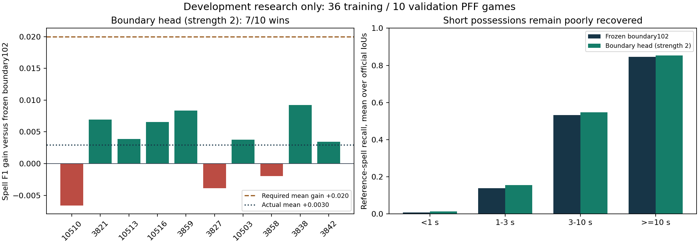

# Separate boundary detector: completed negative development result

16 November 2026. **Neither learned policy passes the preregistered meaningful-improvement gate. Retain frozen boundary102.** This study changes no release weights, source, CSV, visibility or organizer submission. It does not consume another final reserve.

## Question and design

Does a separately supervised geometry model locate H/A handovers and live/dead changes well enough to recover missing possessions? Existing frame posteriors and the four-state duration decoder stay frozen. A new three-class histogram-boosted head supplies time-varying transition penalties, with no negative transition cost. The one-second live/dead minima and metadata period boundaries remain unchanged.

The [plan](plan.json) was committed as `22f7964` before fitting or scoring. Implementation was committed as `1b4a6b9`; the [execution receipt](execution.json), [fit receipts](fits.json) and [training provenance](training_table.json) pin sources, models and samples. Only the existing 36 PFF training matches fit the new head. No development labels, old 29-match labels, organizer materials, events, IDs or component posteriors enter its predictors. Direct/team-swapped geometry probabilities are averaged.

The head sees 108 approved geometry/contact features plus fixed backward/forward differences at 0.2/1 second for 16 features, yielding 172 inputs at 5 Hz. Adjacent known labels supply three targets: unchanged, live H/A handover and live/dead change. All transitions and a fixed stride-ten negative sample are retained, with inverse sampling weights and equal game/scenario/swap weights. Training contains 500,612 rows. Three predeclared fits (seeds 20261113/14/15) use identical fixed hyperparameters and are averaged; no best seed is selected.

## Results

All ten existing PFF development games, natural and fixed blind-seed-seven cases, canonical and fixed SDK-shadow references were retained: **280 score records** including individual-seed diagnostics. Unmodified boundary102 exactly reproduces the earlier frozen scores. Results here are development evidence on familiar games, not a second independent final.

| Policy | Natural Spell F1 | Gain vs boundary102 | Natural wins | Blind Spell F1 | Blind gain |
|---|---:|---:|---:|---:|---:|
| Frozen boundary102 | 0.655231 | 0 | — | 0.642485 | 0 |
| Constant transition cost 6 (control) | 0.656966 | +0.001736 | 6/10 | 0.643912 | +0.001427 |
| Event head, strength 1 | 0.656637 | +0.001406 | 6/10 | 0.645197 | +0.002712 |
| Event head, strength 2 | 0.658198 | +0.002967 | 7/10 | 0.645785 | +0.003300 |

Canonical and fixed SDK-shadow scores agree. Both learned policies pass the mean macro/class and blind regression guards but fail the required **natural gain >=0.020 and >=8/10 game wins**. The strength-two worst natural game loses 0.006611. Its natural macro-F1 gain is only 0.000733; H/A/D gains are 0.000573/0.000806/0.000819. The constant-cost control shows that part of the gain can be obtained without learning any boundary model.

Individual strength-one seed scores range from 0.656834 to 0.657312 natural and 0.644676 to 0.645305 blind. The registered equal ensemble is scored as its own prediction; it need not equal the mean seed metric. No seed rescues the hypothesis or becomes a deployment choice.



## What remains broken

A post-hoc descriptive audit uses the official one-to-one same-team spell matching, averaged over the official IoUs 0.3/0.4/0.5/0.6/0.7. This is **recall conditioned on reference duration**, not a new ranking metric or tuning target. Counts below pool the ten games; match/team dependence remains.

| Reference duration | Reference spells | Frozen recall | Strength-two recall |
|---|---:|---:|---:|
| Under 1 second | 97 | 0.0082 | 0.0144 |
| 1–3 seconds | 481 | 0.1380 | 0.1555 |
| 3–10 seconds | 985 | 0.5328 | 0.5472 |
| At least 10 seconds | 1,124 | 0.8466 | 0.8530 |

These are official scored valid-run spells. Masked reference gaps can split a possession, so these counts differ from whole-metadata-period duration summaries that omit such fragments. The 2,687 reference spells become 2,028 predictions in boundary102 and 2,099 in strength two; more segments do not by themselves establish better segmentation.

Exact-timing boundary average precision at 5 Hz, averaged by game, is 0.0924 for live handovers and 0.1122 for live/dead changes (positive fractions 0.00566/0.00627); blind values are 0.0751/0.1031. These are frame-boundary AP diagnostics, not event precision or possession F1. The head has signal, but the tested likelihood-ratio cost adjustment recovers very few additional short possessions. It cannot directly repair an incorrect or missing team-control emission.

## Decision and next hypothesis

**Do not promote.** In accordance with the original no-gain policy, do not run the 67-cell old audit or open an untouched reserve for this failed candidate. All 67 original frozen release files still match their registered hashes. Five targeted boundary/decoder tests passed, including exact brute-force duration-path optimality, equivalence to the existing constant-cost decoder, period isolation, unknown-target exclusion and transition-type isolation.

The useful next hypothesis is an interval-level ownership model that scores a whole proposed possession, including contact evidence and duration, rather than only lowering a switch cost on unchanged frame emissions. That is an untested direction, not an implemented improvement or promised gain. Training/posterior cross-fitting and a separately declared untouched confirmation set are required before promotion. The current consumed final cannot choose interval scoring rules. The six excluded bridges remain unopened in this cycle.

Reproduce this research from the original authorized PFF training/development caches:

```sh
.venv/bin/python tools/boundary_event_study.py fit
.venv/bin/python tools/boundary_event_study.py pffdev
.venv/bin/python tools/boundary_event_diagnostics.py
```

Completed fits/scores deliberately refuse overwriting. Failed weights and per-frame outputs remain local; the repository preserves source, preregistration, aggregate scores, provenance hashes and the complete negative result. See [all scores and gates](pff_dev_results.json), [duration/seed/AP diagnostics](diagnostics.json) and [literature/data-source scope](SOURCES.md).
