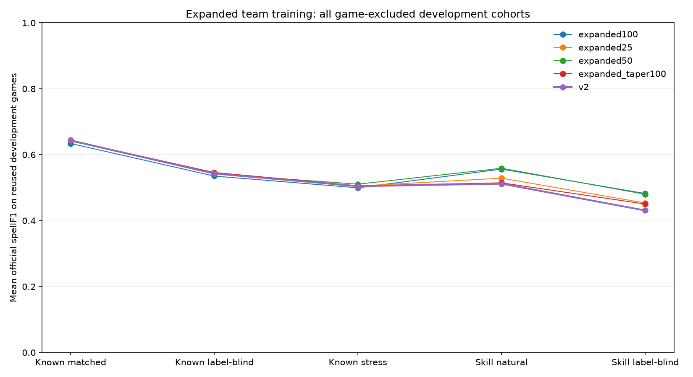
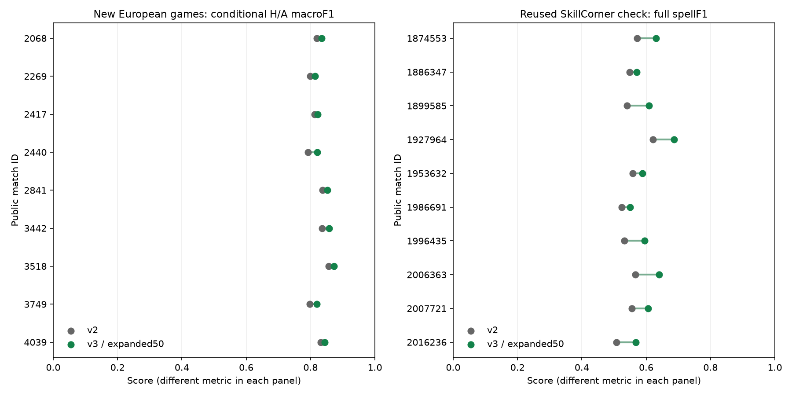

# Nineteen-game team-head training

**Decision: All frozen gates pass.**



We expand only the team-ownership head from the original nine public matches to nineteen: seven IDSSE/DFL games, two Metrica samples and the ten previously designated SkillCorner development games. The original v2 dead-ball probability channel and cost-9/duration decoder remain fixed. No competition observation, public five-minute GT or private GT enters fitting or selection in this cycle.

## Fitting and game isolation

The expanded classifier uses the previous 108 geometry/observed-context features and original 250-iteration histogram gradient boosting settings, random seed 0, no early stopping. Training augments each original game with matched-seed0 / label-blind-seed1 / clean inputs, stride 12 each; each SkillCorner game contributes natural / label-blind-seed7 inputs, stride 8 each. Team-swap augmentation balances home/away examples and inference averages direct and swapped predictions.

The full dataset contributes 747,644 sampled training examples including augmentation and symmetry. Twenty heads are fitted: full nineteen and nineteen leave-one-whole-game-out heads. Every augmentation of a scored game is excluded from its fit; training_provenance.json records these lists and input/model hashes. The original v2 reference probabilities use the earlier nested exclusions on original games and nine-game weights on SkillCorner games. No feature normalization or model statistics are fitted across a held-out game.

SkillCorner references are automatically generated phase-based H/A proxies, differing from mechanically derived corrected-tracking possession used in the competition. We train the new head only on H/A frames; we do not train a new dead-ball classifier from these proxy gaps. Original IDSSE/DFL labels derive from provider tracking ownership/status; Metrica labels derive from events, as documented in the team method.

## Development comparison

We predeclare four policies: 25/50/100 percent expanded-team probabilities at every frame, plus full expanded probabilities tapered within missing-ball gaps. Each keeps the original dead probability channel. The selection weights are 0.4 known matched, 0.2 known label-blind, 0.2 SkillCorner natural and 0.2 SkillCorner label-blind. Required weighted spellF1 gain is ≥0.005 with no mean loss >0.005 in any of the five cohorts below. These games/configuration families were used before; these development results are not fresh independent validation of the entire historical model-selection process.

| Policy | Known matched | Known label-blind | Known stress | Skill natural | Skill label-blind | Weighted gain | Pass |
|---|---:|---:|---:|---:|---:|---:|---|
| expanded50 | 0.6414 | 0.5419 | 0.5105 | 0.5589 | 0.4800 | +0.0184 | True |
| expanded100 | 0.6340 | 0.5351 | 0.4994 | 0.5562 | 0.4822 | +0.0139 | False |
| expanded25 | 0.6445 | 0.5431 | 0.5048 | 0.5287 | 0.4534 | +0.0085 | True |
| expanded_taper100 | 0.6429 | 0.5459 | 0.5056 | 0.5146 | 0.4502 | +0.0049 | False |
| v2 | 0.6432 | 0.5426 | 0.5044 | 0.5119 | 0.4308 | +0.0000 | False |

Frozen candidate: **expanded50**. Its selection timestamp, plan hashes and full-nineteen model hash are in selection.json. No runner-up can be selected after confirmation results.

## Fresh European conditional confirmation

Nine 2019/20 European SkillCorner matches were held outside all training and model-score inspection until this cycle's selected candidate was frozen. Provider ownership is known only on some H/A frames; unknown ownership remains X and is never invented as D. Prediction periods derive independently from tracking periods, not from reference-label availability. We score the actual decoded H/A/D predictions on known-live reference frames using the mean H/A class F1; predicted D remains a miss. This conditional metric is not full-match spellF1 and cannot validate stoppage quality.

Source dates exclude overlap with named 2022/23 DFL and 2024/25 SkillCorner games. A raw first-half trajectory screen found no suspicious alignment with the two anonymized Metrica training games; this heuristic is not a proof of anonymized match identities. Historical author-wide exposure to public data cannot be independently audited. We acknowledge these limits rather than calling all provenance independently verified.

Promotion requires conditional H/A macroF1 gain ≥0.005, positive lower descriptive 95% paired interval and at least seven wins in nine matches. Paired intervals resample whole games 10,000 times, seed 20261113. Different games from one provider remain a small sample; confidence does not transfer automatically to the hidden competition match.

Conditional H/A macroF1: **0.8372 vs v2 0.8203**, difference +0.0169, interval [+0.0134, +0.0209], wins/losses 9/0. Gate pass: **True**.

Additional descriptive breakdown on known-live frames with missing ball tracking: mean conditional H/A macroF1 0.5763 → 0.6074. This subgroup summary is not an additional selection gate; it uses the already frozen predictions and does not evaluate D reference frames.



## Reused full-task secondary check

The prior ten v2-confirmation games are not training inputs for either method, but their historical use means this is a reused secondary cohort, not a new pristine holdout. Evaluate only the frozen new candidate. Require no natural mean spellF1 regression and at most 0.005 mean loss under added label-blind corruption. This checks complete H/A/D behavior because the European references lack D labels.

| Scenario | V2 spellF1 | Selected spellF1 | Difference | Descriptive 95% interval | Wins/losses |
|---|---:|---:|---:|---|---:|
| Natural | 0.5524 | 0.6046 | +0.0522 | [+0.0408, +0.0628] | 10/0 |
| Label-blind corruption | 0.4719 | 0.5156 | +0.0437 | [+0.0364, +0.0506] | 10/0 |

Secondary nonregression gate pass: **True**.

Additional descriptive frame-level D F1 on the same reused natural games changes 0.8580 → 0.8569. Keeping qD fixed does not make decoded D labels identical: changed team probabilities can change the joint temporal path. This small D-class regression is not hidden by the improved overall spellF1.

## Verified production command

`run.py v3` rebuilds the original nine-game stages and the nineteen-game team head. Two clean raw-input reproductions of source `6f067004dc59c45ea7e21be6a7bd4246c7e20651` passed the official validator, matched preflight and produced the same CSV SHA-256 `c501145adc08873ae0bab30e88e9cd2cfa88484210c26bed1e6f9fa667724e40`. Timings: 513.040 s and 511.716 s, four workers. Inputs stayed unchanged; competition GT was not scored. See [the v3 receipt](v3_reproduction.json) and the main README for setup.

## Reproduce

Use README setup, pinned source manifests and prior baseline/nested caches. Copy this report's plans into reports/v4_search before running:

```bash
.venv/bin/python tools/expanded_team_trial.py prepare --jobs 4
.venv/bin/python tools/expanded_team_trial.py fit --jobs 4
.venv/bin/python tools/expanded_team_trial.py score --jobs 4
.venv/bin/python tools/select_expanded_team.py
# Only if development chooses a new candidate:
.venv/bin/python tools/confirm_expanded_team.py fresh --jobs 4
.venv/bin/python tools/confirm_expanded_team.py secondary --jobs 4
reports/plotenv/bin/python tools/report_expanded_team.py
```

The data whitelist is mtah/expanded_team_training.json. The nine European files stay outside it. Raw tracking, labels, arrays, predictions and fitted weights stay local; only code, immutable source references, hashes and aggregate scores are published. The current submission changes only after the frozen gates and technical reproduction pass.

Sources: [IDSSE/DFL mirror](https://huggingface.co/datasets/pysport/idsse-data), CC BY 4.0; [Metrica Sports sample-data](https://github.com/metrica-sports/sample-data), source acknowledged; [SkillCorner open data](https://github.com/SkillCorner/opendata), MIT with SkillCorner attribution; [European release](https://github.com/SkillCorner/opendata/tree/1ed50b775f93075c2a6d00d0d795f13b7b89709e).
