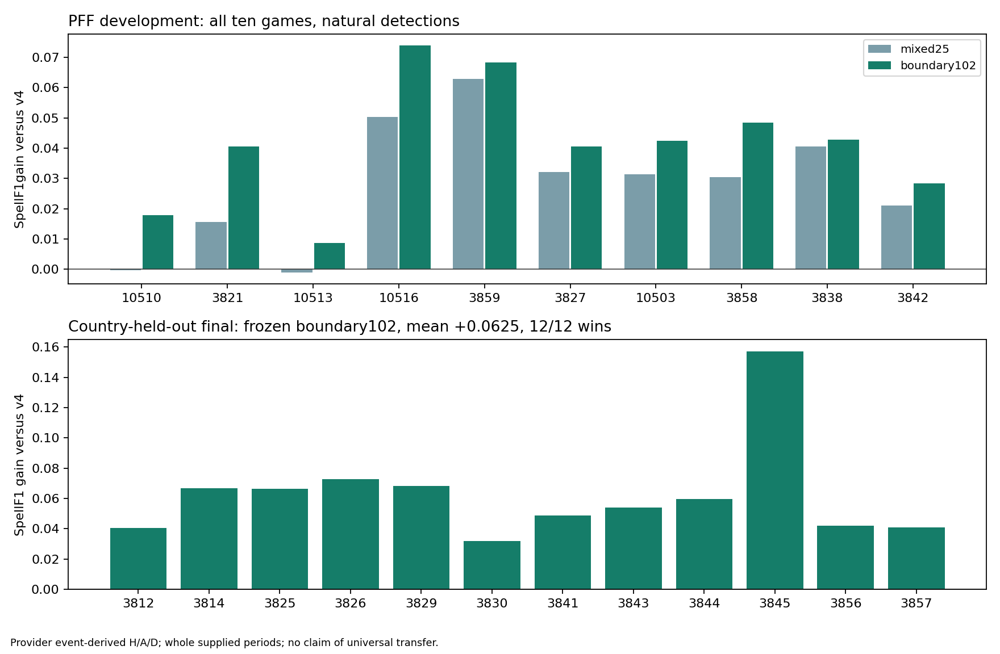

# 65-game temporal and boundary study

Selected before final opening: **boundary102**. Final quality: **PASS: frozen final quality gates**.

## Registered methods and sources

The unchanged v4 release is the control. The temporal branch now trains on65public games: DFL7, Metrica2, SkillCorner20 and original-provider PFF36. The PFF addition contributes5,636,115unaugmented H/A/D period frames; all augmented siblings remain the same match. No organizer labels, PFFdevelopment/final games or country bridges enter any fit or normalizer.

Both fixed variants use48channels,108geometry/contact features plus108finite masks,5Hz, seed20261113,6000AdamWsteps, batch16, LR.001, decay.001, dropout.15 and equal sampling of four providers.6000/4preserves the expected1500updates per older provider relative to4500/3. SkillCorner Dproxy loss weight remains.25. The boosted path, mixture.5and cost9duration decoder are unchanged.

| Variant | Temporal receptive field | Boundary auxiliary loss |
|---|---|---|
| mixed25 |125steps =25seconds;64context steps each side | None |
| boundary102 |509steps =101.8seconds;256context steps each side |.15weighted change BCE; positiveweight8 |

Boundary change probability is1 minus the dot product of adjacent predicted H/A/D distributions. Unknown/context-only pairs are masked; crops never cross independent periods. The longer context and auxiliary loss change together, so these experiments do not separately isolate their individual effects.

PFF geometry uses raw VISIBLE detections only. ESTIMATED tracks, event-informed smoothed coordinates, event/possession fields and identities are excluded from features. References separately follow the pinned primary kloppy state machine and vendor Tracking Specification2.2. They are event-derived proxies, not corrected frame-by-frame competition truth. Training/dev source IDs, clock, periods, coverage and raw/cache hashes are checked. All supplied periods, including extra time when available, are covered; missing tracking frames inside a period remain graded.

Sources: [original PFF release](https://www.blog.fc.pff.com/blog/enhanced-2022-world-cup-dataset), [pinned primary loader](https://github.com/PySport/kloppy/blob/a9651eba7c4dbbe2d2fc6d4cffb4aea63fadac11/kloppy/infra/serializers/tracking/pff.py), [prior source registry](../temporal/REPORT.md). Original raw data and reference arrays are not redistributed. The separate Hugging Face mirror is unused.

## All-stage whole-fold development

The exact29-game fivefold mapping and67scenario cells are retained. Every inherited direct/nested fit excludes the whole scored fold. New neural folds use the remaining23/24older games plus all36PFFtraining games. Actual normalizers are recomputed from those training observations and compared exactly with the checkpoint. The recorded component hashes and transitive exclusions are verified. Both immutable historical-v4 and identical-exclusion reconstructed-v4 numeric gates are required.

| Variant | Candidate composite | Gain vs historical v4(.61435) | Wins | Gain vs strict v4(.61218) | Wins |
|---|---:|---:|---:|---:|---:|
| mixed25 | 0.63602 | +0.02168 | 27/29 | +0.02384 | 29/29 |
| boundary102 | 0.64317 | +0.02882 | 27/29 | +0.03099 | 29/29 |

All old-family/cohort, class, stress, lower-tail, large-loss and descriptive-bootstrap gates pass for both variants. These are reused research games, so intervals do not remove historical model-selection or opponent dependence.

## PFFdevelopment: all ten games

None of these games trains any learned stage or normalizer. They are now a model-selection set, not an untouched final estimate. The original frozen-v4 outputs are recomputed exactly on every sensor cell. Canonical and fixed SDK-shadow references agree on these ten games.

| Variant/scenario | V4 spellF1 | Candidate | Gain | Game wins | MacroF1gain |
|---|---:|---:|---:|---:|---:|
| mixed25/natural_detected | 0.61404 | 0.64230 | +0.02826 | 8/10 | +0.01293 |
| mixed25/label_blind_seed7 | 0.60246 | 0.63413 | +0.03167 | 10/10 | +0.01137 |
| boundary102/natural_detected | 0.61404 | 0.65523 | +0.04119 | 10/10 | +0.01772 |
| boundary102/label_blind_seed7 | 0.60246 | 0.64249 | +0.04003 | 10/10 | +0.01559 |

Both variants pass the predeclared natural mean+.02, at least7/10wins, macro/class and sensor-stress/sensitivity guards. No failed match is dropped.

## Eleven reused external regression games

| Cohort/scenario | mixed25primary gain | boundary102primary gain |
|---|---:|---:|
| european/natural_detected | -0.00017 | -0.00365 |
| metrica3/label_blind_seed7 | +0.00908 | -0.00900 |
| metrica3/natural_detected | +0.00792 | +0.00299 |
| wcsf/label_blind_seed7 | +0.00953 | +0.00961 |
| wcsf/natural_detected | -0.00720 | +0.01569 |

The European9primary metric is conditional H/A macroF1, not full H/A/D spellF1. WCSF and Metrica3 use their previously documented reference/provenance caveats. Each predeclared cohort/scenario mean-loss guard is.01. Boundary102 loses.00900 on the noisy Metrica3 scenario, close to that limit. Improvements are not universal.

## Spell count and duration diagnostics

On PFF development natural inputs, the mean per-game predicted/reference spell-count ratio is 0.755 versus v4 0.739. Mean predicted possession duration is 17.54s versus reference 13.75s. The model still merges/misses short possessions; better spellF1 does not mean perfect segmentation. These are post-selection descriptive diagnostics, not an added gate or a reason to change the frozen model.

## Selection and exact-file verification

Both variants satisfy every registered development requirement plus DFL/Metrica/SkillCorner provider guards. The fixed ranking is the mean of historical-v4 development gain and PFFdev natural gain; boundary102 wins. There is no seed, decoder, gate or runner-up selection on final data. The original two failed source/reference and29-only PFF-transfer studies remain preserved under `../pff`.

Deployment exactly reproduces the previously scored dev3821predictions for natural and blind cases, both control and candidate: zero differing frame labels. Two clean committed-source CPU generations produce the same exact organizer CSV and pass the official format validator; this is frozen-weight inference reproduction, not repeated training or hidden target-quality validation.

CPU runs: 26.779s and 26.838s; peak child RSS 1533.09MiB. CSV SHA256: `cfbd16ea35075a199d2401c18f162d4c1f953be4049cd776d502ff42ea389c97`. Source: `d10dd97438c3f07ed38a568e76d9d93bce6cd95b`.

## Original twelve-game final reserve

The original groupsA/H country-isolated split is unchanged; both national teams are absent from all PFFtrain/dev matches. One candidate, source/model/reader/scenario hashes and exact-file receipts are frozen before any final contents. Opening consumes the reserve even after failure. All12games and both fixed sensor cases are required. The final natural mean gain must be>=.02with>=9wins, both group gains positive, macro loss<=.01, blind spell loss<=.01and fixed SDK sensitivity loss<=.01. A source/adapter failure blocks promotion instead of changing the endpoint or dropping a match.

**PASS: frozen final quality gates**

| Final comparison | V4 | Candidate | Gain | Wins |
|---|---:|---:|---:|---:|
| canonical/natural_detected | 0.54180 | 0.60428 | +0.06248 | 12/12 |
| canonical/label_blind_seed7 | 0.52648 | 0.58696 | +0.06048 | 12/12 |
| sdk_shadow/natural_detected | 0.54180 | 0.60428 | +0.06248 | 12/12 |
| sdk_shadow/label_blind_seed7 | 0.52648 | 0.58696 | +0.06048 | 12/12 |

Group gains: {'A': 0.07075529126026982, 'H': 0.05419680189303575}. Descriptive paired whole-game95%gain interval: [0.048269875874350866, 0.08266441418935419]. Shared national teams and only two groups limit independence assumptions.

## Post-selection train/CV diagnostic

Standalone neural branch only, before the50/50fusion. Same29primary natural/matched game inputs; full-fit training-game predictions versus complete-fold-out predictions. No weights, gates or selection change after this diagnostic.

| Source | Games | Full-fit spellF1 | Whole-fold-out | Optimism gap |
|---|---:|---:|---:|---:|
| DFL | 7 | 0.68989 | 0.66764 | +0.02225 |
| Metrica | 2 | 0.85653 | 0.70556 | +0.15097 |
| SkillCorner | 20 | 0.70864 | 0.71486 | -0.00622 |

The two-game Metrica gap of.151indicates a material source-specific overfit risk. DFLshows modest training optimism; SkillCorner does not show a positive gap here. This does not invalidate the complete-pipeline held-out comparisons, but absence of overfit cannot be claimed. The frozen final12result is separately reported above.

Generalization remains conditional on sensor/reference semantics and sampled matches; no universal/no-overfit or competition-rank claim. The provided match is never used for supervised fitting, candidate selection or quality scoring. Publication and organizer submission are separate steps and remain on hold.

