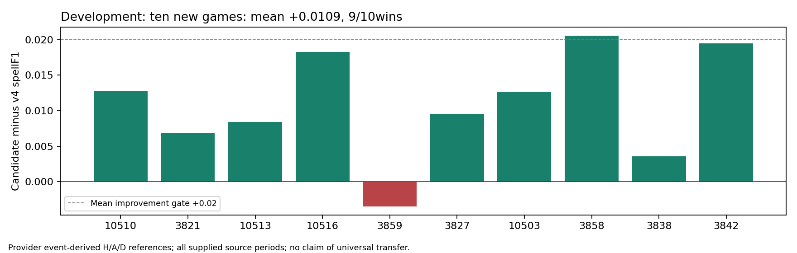

# Original PFF transfer validation

One frozen provider-balanced candidate (source_seed20261113) is compared with unchanged v4. Neither model is fitted on PFF. Candidate selection predates all PFF quality scores. The original36training/10development/12final/6excluded-bridge split is unchanged. All earlier40screened games are reused research; PFF development is new-provider evidence but becomes development once examined.

## Source and annotation boundaries

Original provider access followed an explicitly authorized contact/newsletter form. The Hugging Face mirror request remains pending and no gated mirror files are used. Source: [PFF enhanced World Cup release](https://www.blog.fc.pff.com/blog/enhanced-2022-world-cup-dataset). Vendor Tracking Specification2.2 and pinned [PySport/kloppy loader](https://github.com/PySport/kloppy/blob/a9651eba7c4dbbe2d2fc6d4cffb4aea63fadac11/kloppy/infra/serializers/tracking/pff.py) define the separately reconstructed ball state/owning team.

Features use only raw VISIBLE ball/player observations; no ESTIMATED tracks, event-informed ballsSmoothed, event fields, identities, source labels or reference-conditioned corruption. Independent period numbers and frame/video timestamps define prediction spans. All supplied periods are evaluated, including missing tracking frames inside them. This is coverage of each supplied source clip, not a claim that extra time or penalties are included. Public match IDs, source team identities and raw hashes are verified.

Reference H/A/D is a provider-event-derived proxy, not corrected frame-by-frame competition truth. OUT/END marks dead, kickoff/OTB marks live, and home_ball supplies ownership; other events preserve state. Canonical references reset unknown state at each independent period and mask contradictory duplicates. A fixed last-row SDK-state shadow supplies a separate sensitivity check. Neither reference is selected by model scores. Training3816/3813 and dev3821 were source-format pilots only. The failed one-owner-per-sequence prototype remains preserved separately; numeric thresholds and candidate were not changed to fix it.

## Fixed procedure

All ten development games must pass the registered gates before final content is opened: natural mean spell gain>=.02, at least7wins, macro loss<=.01, each class loss<=.02, blind mean spell loss<=.01. Final uses evaluation-1.0: mean natural gain>=.02, at least9/12wins, positive gain in both groupsA/H, macro loss<=.01, blind mean loss<=.01. SDK sensitivity loss<=.01 is an additional conservative guard. Missing/invalid games cannot be dropped or converted into conditional H/A evaluation.

Paired probabilities exactly reproduce both frozen entrypoints on training3816 (zero maximum difference). Predictions are reference-blind; development predictions are saved before reference caches are opened. The official scorer is unchanged. Individual augmentations are not counted as independent games. Final requires a committed code/model/reader/plan freeze before any final content, and a once-only opening marker that consumes the reserve even after failure. No runner-up or post-test model choice is allowed.

No organizer-match ground truth is used for PFF scoring, fitting, calibration or candidate selection. Raw PFF data, reference arrays and frame predictions are ignored by Git and not redistributed. Publication and submission readiness remain separate from these numeric gates.

## Development: ten new games

**FAIL: do not open final reserve**

| Scenario/reference | V4 | Candidate | Gain | Game wins |
|---|---:|---:|---:|---:|
| canonical/natural_detected | 0.61404 | 0.62489 | +0.01085 | 9 |
| canonical/label_blind_seed7 | 0.60246 | 0.60927 | +0.00682 | 10 |
| sdk_shadow/natural_detected | 0.61404 | 0.62489 | +0.01085 | 9 |
| sdk_shadow/label_blind_seed7 | 0.60246 | 0.60927 | +0.00682 | 10 |

| Check | Result |
|---|---|
| natural_gain | FAIL |
| game_wins | PASS |
| macro_guard | PASS |
| H_guard | PASS |
| A_guard | PASS |
| D_guard | PASS |
| blind_guard | PASS |
| shadow_natural_detected | PASS |
| shadow_label_blind_seed7 | PASS |

| Game | V4 natural spellF1 | Candidate | Gain |
|---|---:|---:|---:|
| 10510 | 0.66541 | 0.67818 | +0.01277 |
| 3821 | 0.55747 | 0.56430 | +0.00683 |
| 10513 | 0.62843 | 0.63682 | +0.00838 |
| 10516 | 0.60342 | 0.62165 | +0.01823 |
| 3859 | 0.55250 | 0.54904 | -0.00346 |
| 3827 | 0.66047 | 0.67002 | +0.00956 |
| 10503 | 0.61907 | 0.63172 | +0.01265 |
| 3858 | 0.56364 | 0.58420 | +0.02056 |
| 3838 | 0.61803 | 0.62158 | +0.00354 |
| 3842 | 0.67200 | 0.69145 | +0.01945 |

