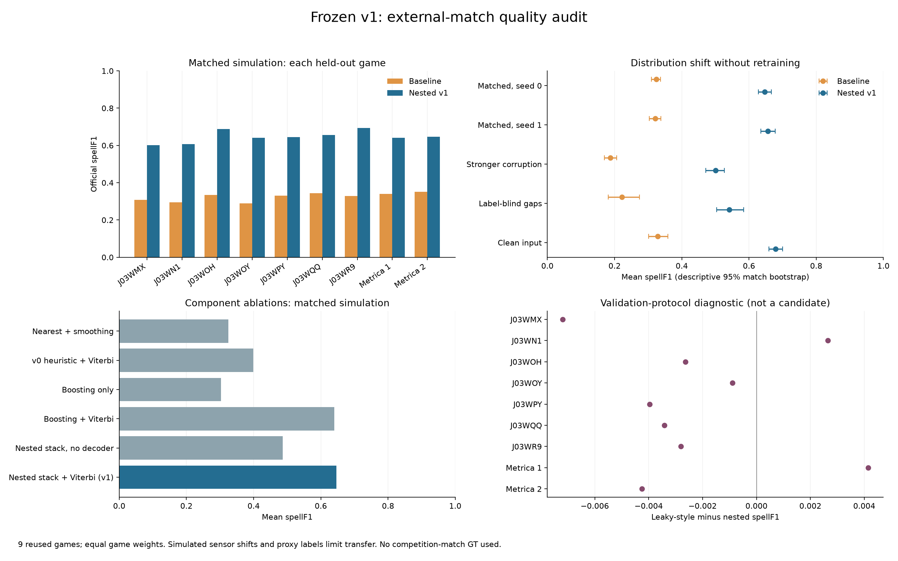

# External quality audit: fixed v1

Protocol `380987b3029cb161e9d5601a6286a2c4af425d9300a64322a90d7b2c63cfaaa9`; model/evaluation source `dc43fea1db2edb6e652d3c6233aa958b5273b07c`.



This retrospective audit isolates the held-out match from fitting both learned stages. It does not undo historical hyperparameter/model selection on these known games. It evaluates external games only; competition tracking, the public five-minute GT and the all-data checkpoint are blocked by the audit's I/O guard.

For each of nine outer test games, stage one fits the other eight games. Each inner stage-two training game receives first-stage predictions from a fit on seven games excluding both the outer test game and that inner game. Stage two fits the eight inner games, then predicts the outer game. The 36 omitted-pair fits are reused in both directions; nine outer fits bring the total to 45 first-stage fit groups. Fixed hyperparameters and decoder settings are identical across folds.

## Primary comparison: nine games, matched sensor simulation

Each game has equal weight. Intervals resample whole games in pairs (10,000 draws, seed 20261112, 95% percentiles). With nine reused games and overlapping training folds these are descriptive intervals, not proof of generalization to the hidden competition match.

| Method | Mean spellF1 | Descriptive 95% interval | Mean macroF1 | Possession-count ratio |
|---|---:|---|---:|---:|
| Nearest + smoothing | 0.3244 | [0.310, 0.337] | 0.7528 | 1.20 |
| v0 heuristic + Viterbi | 0.3990 | [0.388, 0.410] | 0.7742 | 0.96 |
| Boosting only | 0.3032 | [0.290, 0.317] | 0.8946 | 3.01 |
| Boosting + Viterbi | 0.6401 | [0.622, 0.657] | 0.8956 | 0.81 |
| Nested stack, no decoder | 0.4871 | [0.465, 0.513] | 0.8961 | 1.47 |
| Nested stack + Viterbi (v1) | 0.6466 | [0.627, 0.666] | 0.8961 | 0.76 |
| v1, no explicit duration minimum | 0.6455 | [0.627, 0.664] | 0.8961 | 0.77 |
| v1, minimum 0.4 s | 0.6455 | [0.627, 0.664] | 0.8961 | 0.77 |
| v1, minimum 2 s | 0.6376 | [0.613, 0.660] | 0.8951 | 0.72 |

The full model predicts 0.76 times as many possession spells as the reference on average. Despite the spellF1 gain, it merges some distinct possessions. Removing the stack costs 0.0064 spellF1 (7 wins, 2 losses); removing the decoder costs 0.1595. The one-second minimum adds 0.0010 over no explicit duration minimum, interval [-0.000, 0.002]. The duration effect is much smaller than the decoder effect.

V1 minus baseline: **+0.3222 spellF1**, interval [0.306, 0.340]; wins/losses/ties: 9/0/0.

## Per-game results

| Game | Baseline spellF1 | No-stack + Viterbi | Nested v1 spellF1 | V1 macroF1 | True / predicted possessions |
|---|---:|---:|---:|---:|---:|
| idsse_J03WMX | 0.3075 | 0.5907 | 0.6012 | 0.9195 | 511 / 320 |
| idsse_J03WN1 | 0.2953 | 0.6062 | 0.6076 | 0.9089 | 500 / 344 |
| idsse_J03WOH | 0.3339 | 0.6676 | 0.6882 | 0.9308 | 402 / 292 |
| idsse_J03WOY | 0.2887 | 0.6466 | 0.6405 | 0.9159 | 456 / 354 |
| idsse_J03WPY | 0.3300 | 0.6453 | 0.6450 | 0.9199 | 421 / 286 |
| idsse_J03WQQ | 0.3436 | 0.6522 | 0.6555 | 0.9183 | 401 / 313 |
| idsse_J03WR9 | 0.3294 | 0.6810 | 0.6945 | 0.9382 | 370 / 290 |
| metrica_1 | 0.3394 | 0.6337 | 0.6401 | 0.8030 | 326 / 307 |
| metrica_2 | 0.3516 | 0.6380 | 0.6466 | 0.8105 | 326 / 279 |

## Robustness without retraining

Models train on matched seed 0 only. Alternative sensor scenarios change the held-out inputs. Strong corruption halves typical track-fragment lengths, increases gaps/noise and targets 40% ball visibility. Clean source uses unmodified external tracking. The label-blind scenario chooses ball gaps from observable geometry, not live/dead labels.

| Scenario | Baseline spellF1 | Nested v1 spellF1 | V1 − baseline | Paired interval | Wins / losses |
|---|---:|---:|---:|---|---:|
| matched_seed0 | 0.3244 | 0.6466 | +0.3222 | [0.306, 0.340] | 9 / 0 |
| matched_seed1 | 0.3207 | 0.6566 | +0.3359 | [0.314, 0.356] | 9 / 0 |
| stress_seed1 | 0.1874 | 0.5011 | +0.3136 | [0.293, 0.332] | 9 / 0 |
| label_blind_seed1 | 0.2215 | 0.5413 | +0.3198 | [0.300, 0.342] | 9 / 0 |
| clean_source | 0.3284 | 0.6788 | +0.3503 | [0.313, 0.384] | 9 / 0 |

## Source-family differences

Metrica labels are event-derived proxies; DFL labels use provider tracking possession/status fields. Do not treat these as identical annotation processes. The author's reserved subset is historical, not newly untouched data.

| Cohort | Games | Baseline spellF1 | Nested v1 spellF1 |
|---|---:|---:|---:|
| DFL | 7 | 0.3184 | 0.6475 |
| Metrica | 2 | 0.3455 | 0.6434 |
| author_reserved | 3 | 0.3401 | 0.6604 |

## Ablation effects (default v1 minus alternative)

| Alternative | Δ spellF1 | Paired interval |
|---|---:|---|
| Nearest + smoothing | +0.3222 | [0.306, 0.340] |
| v0 heuristic + Viterbi | +0.2476 | [0.234, 0.263] |
| Boosting only | +0.3434 | [0.328, 0.359] |
| Boosting + Viterbi | +0.0064 | [0.002, 0.012] |
| Nested stack, no decoder | +0.1595 | [0.143, 0.175] |
| v1, no explicit duration minimum | +0.0010 | [-0.000, 0.002] |
| v1, minimum 0.4 s | +0.0010 | [-0.000, 0.002] |
| v1, minimum 2 s | +0.0089 | [0.002, 0.017] |

No explicit duration minimum still leaves the decoder's one-block (0.2 s) discretization. The 0.4 s / 2 s runs are a prespecified sensitivity analysis, not a new selected submission.

## Additional game outside the implemented training corpus

Metrica Sample_Game_3: 143,761 tracking frames, 142,698 graded frames and 3,620 provider events. The frozen full-nine-game checkpoint was evaluated without training or retuning on this game. Its hash was registered before scoring. Labels are event-derived proxies; only event-covered period spans are graded. This game is separate from the nine-game mean. Historical author-wide exposure to this public game cannot be independently audited.

| Input scenario | Baseline spellF1 | Frozen v1 spellF1 | V1 macroF1 |
|---|---:|---:|---:|
| clean_source | 0.3598 | 0.6837 | 0.8502 |
| matched_seed0 | 0.3206 | 0.6152 | 0.8299 |
| label_blind_seed1 | 0.2813 | 0.6093 | 0.8207 |
| stress_seed1 | 0.1793 | 0.4815 | 0.7271 |

## Non-nested stacking diagnostic

Historical leaky-style evaluation minus nested evaluation: -0.0020 spellF1, descriptive paired interval [-0.004, 0.000]. This diagnostic is excluded from valid quality comparisons; its sign does not change the structural exclusion error. Nested inner models train on seven rather than eight games, so this difference combines training-size effects and contamination; it is not a pure causal estimate of leakage optimism.

## Limitations and interpretation

- All nine games and configuration choices were already known to the model author. Estimator cross-fitting is isolated, but this is not pristine independent validation of the entire historical selection process.
- Matched v2 corruption uses external live/dead labels to simulate sensor dropouts. These scores are conditional on that assumed sensor model. Label-blind and clean-input results test this dependence; none establishes the actual competition sensor distribution.
- The seven DFL games and two Metrica samples are a small, heterogeneous sample. Thousands of frames are not thousands of independent matches.
- Oracle-equals-GT and constant-dead spellF1 sanity checks passed in each fold. Metrics come from the unmodified pinned organizer evaluator.
- Per-game bootstrap fields in raw records use the organizer's default 5th/95th percentiles (90%). The tables here use a separate descriptive 95% bootstrap over whole games.
- No final CSV or v1 configuration was changed based on this audit. Competitive quality on the hidden full-match GT remains unknown.

## Reproduction

```bash
.venv/bin/python tools/quality_audit.py --jobs 4
.venv/bin/python tools/prepare_fresh_holdout.py --jobs 2
.venv/bin/python tools/fresh_metrica_holdout.py
python3.12 -m venv reports/plotenv
reports/plotenv/bin/python -m pip install -r requirements-quality-plots.txt
# Use the resulting protocol directory:
reports/plotenv/bin/python tools/summarize_quality_audit.py reports/quality_audit/380987b3029c --plot --fresh reports/fresh_holdout/results.json
```

Raw inputs are the pinned external sources from tools/external_sources.json. Full records: metrics.csv / results.json. Split provenance and input/source hashes: protocol.json plus stage1/*.json and scores/*.json (local).
[Nested-evaluation background, scikit-learn](https://scikit-learn.org/stable/auto_examples/model_selection/plot_nested_cross_validation_iris.html).

Data attribution: [IDSSE / DFL / Sportec, PySport mirror](https://huggingface.co/datasets/pysport/idsse-data), CC BY 4.0, Bassek et al. (2025); [Metrica Sports sample-data](https://github.com/metrica-sports/sample-data), source acknowledged as required by its README.
