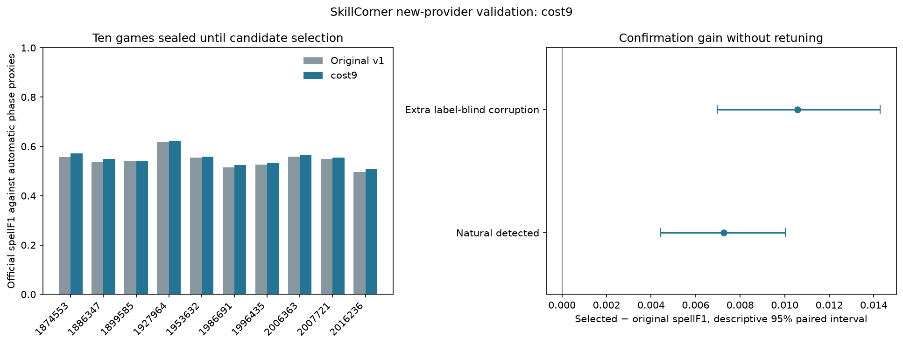

# New-provider validation and improvement experiments



Selected before sealed scoring: **cost9**. Adoption decision: **PROMOTE**.

We fetched 20 SkillCorner A-League matches from pinned source revision `4340d274572876239c154c90bc507a9b3250a656`, under MIT with SkillCorner attribution. None is among the original nine training games. A seeded split fixed ten development and ten confirmation matches before the first new-game score. The original Metrica Sample_Game_3 is not an untouched holdout anymore after its earlier published evaluation; it is not used as the confirmation set here.

## What changed

Nine prespecified decoder configurations include original v1, transition costs 3/6/9, duration 0.4/1 s, and dead-logit offsets ±0.35 in the combinations recorded in plan.json. Two further prespecified learned candidates use the original stage-one boosting settings and original nine training games with matched, label-blind and clean sensor inputs. Stride 12 per input scenario keeps the approximate training-row budget comparable to original stride 4 on one scenario. `robust_stage1` uses these weights directly; `blend50` averages their conditional dead/home probabilities with the original v1 stacked probabilities, with equal fixed weights and the original decoder. No SkillCorner game trains learned weights.

Known-game scores for robust stage one exclude the scored match from all its training scenarios. Original v1 predictions use the earlier nested stage-two audit. Development selection combines known matched / known label-blind / new natural / new label-blind means with weights 0.4/0.2/0.2/0.2. Gates reject matched or known-stress losses >0.005 and new natural losses >0.01. A candidate needs a weighted gain ≥0.002. We freeze one candidate before any confirmation score; confirmation outcomes cannot select a runner-up.

## Development results (used for selection)

| Candidate | Known matched | Known label-blind | Known stress | New natural | New label-blind | Weighted score | Eligible |
|---|---:|---:|---:|---:|---:|---:|---|
| cost9 | 0.6432 | 0.5426 | 0.5044 | 0.5119 | 0.4308 | 0.5544 | True |
| blend50 | 0.6490 | 0.5615 | 0.5254 | 0.4877 | 0.4226 | 0.5539 | False |
| cost6_deadplus | 0.6461 | 0.5363 | 0.4914 | 0.5077 | 0.4211 | 0.5515 | False |
| v1 | 0.6466 | 0.5413 | 0.5011 | 0.4991 | 0.4184 | 0.5504 | True |
| cost6_deadminus | 0.6453 | 0.5488 | 0.5093 | 0.4926 | 0.4157 | 0.5495 | True |
| cost6_duration04 | 0.6455 | 0.5405 | 0.5011 | 0.4977 | 0.4173 | 0.5493 | True |
| cost3 | 0.6455 | 0.5359 | 0.4981 | 0.4836 | 0.4022 | 0.5426 | False |
| cost3_duration04 | 0.6431 | 0.5354 | 0.4979 | 0.4799 | 0.3991 | 0.5401 | False |
| cost3_deadplus | 0.6419 | 0.5263 | 0.4883 | 0.4874 | 0.4009 | 0.5397 | False |
| cost3_deadminus | 0.6430 | 0.5413 | 0.5070 | 0.4727 | 0.3966 | 0.5393 | False |
| robust_stage1 | 0.6407 | 0.5655 | 0.5247 | 0.4384 | 0.3870 | 0.5344 | False |

Known-game trade-offs are part of the selection evidence, not an independent confirmation. On matched inputs the selected decoder loses six games and wins three: mean change -0.0033, descriptive paired 95% interval [-0.0080, +0.0017]. The interval includes zero and does not establish equivalence. Natural SkillCorner v1 predictions also have the opposite count bias to matched DFL/Metrica: about 1.48 times the reference possession count on the development cohort, versus about 0.76 on the known matched cohort. Increasing possession counts everywhere would therefore be a poor global correction.

## Confirmation: ten games unseen during selection

| Scenario | Nearest baseline | Original v1 | Selected candidate | Paired Δ | Descriptive 95% interval | Wins / losses |
|---|---:|---:|---:|---:|---|---:|
| natural_detected | 0.3621 | 0.5451 | 0.5524 | +0.0073 | [+0.0044, +0.0100] | 9 / 1 |
| label_blind_seed7 | 0.2292 | 0.4613 | 0.4719 | +0.0106 | [+0.0070, +0.0143] | 10 / 0 |

Paired intervals resample whole games 10,000 times, seed 20261113. They are descriptive: ten matches from one league/provider do not establish performance on the hidden competition match. Promotion requires natural gain ≥0.005, positive lower interval bound, at least seven natural-game wins and no label-blind stress loss >0.005. The rule was registered before confirmation.

| Confirmation match | Original v1 spellF1 | Selected spellF1 | Difference | Reference / v1 / selected possessions |
|---|---:|---:|---:|---:|
| 1874553 | 0.5574 | 0.5713 | +0.0140 | 250 / 360 / 343 |
| 1886347 | 0.5352 | 0.5481 | +0.0129 | 237 / 343 / 322 |
| 1899585 | 0.5410 | 0.5407 | -0.0003 | 278 / 369 / 356 |
| 1927964 | 0.6176 | 0.6205 | +0.0029 | 205 / 295 / 283 |
| 1953632 | 0.5546 | 0.5576 | +0.0029 | 219 / 319 / 309 |
| 1986691 | 0.5156 | 0.5237 | +0.0082 | 240 / 345 / 329 |
| 1996435 | 0.5271 | 0.5326 | +0.0055 | 234 / 345 / 333 |
| 2006363 | 0.5577 | 0.5668 | +0.0092 | 235 / 351 / 338 |
| 2007721 | 0.5494 | 0.5551 | +0.0057 | 248 / 357 / 345 |
| 2016236 | 0.4956 | 0.5072 | +0.0116 | 300 / 428 / 405 |

## Label and sensor limitations

SkillCorner phase labels are generated automatically. Phase intervals are treated as H/A; the complement inside independently supplied metadata periods is D, outside is X. This assumes phase coverage is exhaustive and differs from the competition's mechanically derived corrected-tracking ownership. Some provider phase endpoints extend outside metadata halves: we intersect them with their declared period, without shifting or hand-correcting any phase. This is a proxy-label benchmark, not an official competition score.

The source is 10 Hz. Adjacent finite detected positions are interpolated to 25 Hz; we preserve gaps and derive speeds at the native sampling rate. Extrapolated player/ball positions, tracking possession fields, event-derived coordinates and phase labels never enter model features. Period boundaries supply the eligible spans. Natural detection gaps and camera framing differ from tactical tracking. The label-blind scenario adds geometry-driven ball gaps, player fragmentation and noise without using live/dead classes to choose missing frames.

We retain original v1 unless the frozen promotion rule passes. We do not use the competition public five-minute GT or hidden full-match GT to tune this cycle. No code or documentation can guarantee qualification; organizers have not published other teams' scores.

## Reproduce

Run the original external-data setup from README first, then:

```bash
.venv/bin/python tools/fetch_skillcorner.py
# Preserve/copy the published plans to reports/v2_search before scoring.
.venv/bin/python tools/decoder_development.py --cohort development --jobs 4
.venv/bin/python tools/decoder_development.py --cohort known --jobs 2
.venv/bin/python tools/robust_training_trial.py fit --jobs 4
.venv/bin/python tools/robust_training_trial.py development --jobs 2
.venv/bin/python tools/robust_training_trial.py known --jobs 4
.venv/bin/python tools/select_external_candidate.py
.venv/bin/python tools/decoder_development.py --cohort confirmation --jobs 4
# If the frozen selection is robust_stage1 or blend50:
.venv/bin/python tools/robust_training_trial.py confirmation --jobs 4
reports/plotenv/bin/python tools/report_skillcorner.py
```

The known-game stage uses the cached nested audit at reports/quality_audit/380987b3029c; reconstruct it with the original committed audit source and pinned external data before this run. Hashes/plans, per-game aggregate records and training exclusions accompany this report. Raw tracking, frame-level predictions and weights remain local.

Data: [SkillCorner Open Data](https://github.com/SkillCorner/opendata), [pinned README](https://github.com/SkillCorner/opendata/blob/4340d274572876239c154c90bc507a9b3250a656/README.md), [MIT licence](SkillCorner-LICENSE.txt). We credit SkillCorner and PySport for making these data available.
