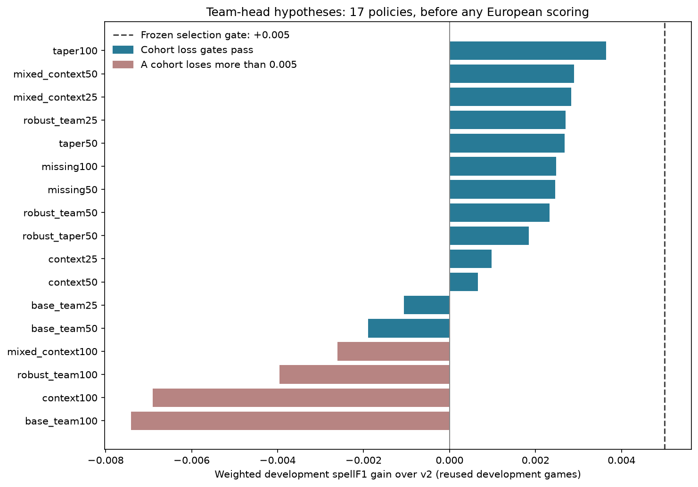

# Team ownership experiments after v2

Historical report: the nine European games were unscored at this stage. A subsequent [expanded-training study](../expanded-team/REPORT.md) evaluated them once; they are no longer an unused confirmation pool.

**Decision: No candidate clears frozen development gate; retain v2; European games remain unscored.**



The current submission remains v2 unless a new candidate passes both the predeclared development gate and its later confirmation. This report does not score the competition match, use its public GT for selection, or reuse v2's ten confirmation games as a fresh test.

## Hypotheses and isolation

The diagnostic replaces individual probability channels with answers from external reference labels. With the team channel replaced, known matched spellF1 rises from 0.6432 to 0.8934; replacing only dead probabilities gives 0.6695. These are oracle diagnostics, not deployable model scores or strict global upper bounds: the frozen duration decoder still imposes constraints.

We added 21 observable features: previous/following actually observed team-distance margins, nearest-player distances/counts and ball speeds, decayed endpoint evidence, endpoint agreement/change, and visible-only temporal averages. Carries and windows reset at period boundaries. A team-only boosting head retains v1's model parameters, training on the nine original games; each known test match is excluded. Dead-ball probabilities and cost-9 decoding stay fixed. The original nested stack predictions remain the baseline. No new team head consumes the scored game's labels during fitting.

Controls separate added features from bypassing the old team stack. Another family retains the old three-sensor robust team head while preserving the original stacked dead head. A mixed-context head trains with matched, label-blind and clean inputs, stride 12 each. Fixed 25/50/100 percent blends test these four families (12 policies). After this bounded set failed the development gate, an explicitly logged follow-up tests five gap-specific policies. Two use hard missing-ball masks; two taper the mixed-context contribution toward zero at each gap edge with one-second exponentials; one uses the original robust head with tapering. These five policies were registered before their scores and keep the original threshold.

## Development scores, including regressions

Selection weights known matched / known label-blind / SkillCorner development natural / SkillCorner development label-blind means by 0.4/0.2/0.2/0.2. A candidate needs weighted gain ≥0.005 and may not lose more than 0.005 in known matched, new natural or new label-blind means. Stress is reported separately. These data were already used in earlier development; these are not new independent generalization estimates.

| Policy | Known matched | Known label-blind | Known stress | Skill natural | Skill label-blind | Weighted gain | Pass |
|---|---:|---:|---:|---:|---:|---:|---|
| taper100 | 0.6438 | 0.5507 | 0.5099 | 0.5148 | 0.4369 | +0.0036 | False |
| mixed_context50 | 0.6465 | 0.5508 | 0.5094 | 0.5086 | 0.4338 | +0.0029 | False |
| mixed_context25 | 0.6474 | 0.5465 | 0.5071 | 0.5115 | 0.4332 | +0.0028 | False |
| robust_team25 | 0.6477 | 0.5467 | 0.5061 | 0.5116 | 0.4316 | +0.0027 | False |
| taper50 | 0.6442 | 0.5471 | 0.5080 | 0.5141 | 0.4355 | +0.0027 | False |
| missing100 | 0.6427 | 0.5497 | 0.5089 | 0.5132 | 0.4359 | +0.0025 | False |
| missing50 | 0.6436 | 0.5481 | 0.5088 | 0.5131 | 0.4357 | +0.0025 | False |
| robust_team50 | 0.6482 | 0.5457 | 0.5077 | 0.5117 | 0.4296 | +0.0023 | False |
| robust_taper50 | 0.6439 | 0.5457 | 0.5074 | 0.5133 | 0.4343 | +0.0018 | False |
| context25 | 0.6453 | 0.5442 | 0.5067 | 0.5111 | 0.4308 | +0.0010 | False |
| context50 | 0.6457 | 0.5451 | 0.5098 | 0.5089 | 0.4297 | +0.0007 | False |
| v2 | 0.6432 | 0.5426 | 0.5044 | 0.5119 | 0.4308 | +0.0000 | False |
| base_team25 | 0.6424 | 0.5417 | 0.5048 | 0.5101 | 0.4298 | -0.0011 | False |
| base_team50 | 0.6441 | 0.5406 | 0.5055 | 0.5073 | 0.4262 | -0.0019 | False |
| mixed_context100 | 0.6439 | 0.5487 | 0.5071 | 0.4980 | 0.4242 | -0.0026 | False |
| robust_team100 | 0.6471 | 0.5466 | 0.5041 | 0.4888 | 0.4225 | -0.0040 | False |
| context100 | 0.6415 | 0.5388 | 0.5060 | 0.4980 | 0.4174 | -0.0069 | False |
| base_team100 | 0.6409 | 0.5403 | 0.5039 | 0.4964 | 0.4162 | -0.0074 | False |

The 17 policies share games and predictions; hundreds of records are not hundreds of independent matches. No interval from this selection search is presented as confirmatory. The known-game live-team frame accuracy check improves during missing-ball frames (about 0.77 to 0.80 for a 50% mixed-context blend), but frame accuracy alone does not establish better possession spells.

## Nine additional European matches

We recovered the original 2019/20 SkillCorner open-data release at `1ed50b775f93075c2a6d00d0d795f13b7b89709e`: nine matches in England, Spain, Germany, Italy and France, absent from the implemented training corpus. These are different games from the competition fixture. We verified publisher object hashes and converted observations without using ownership fields as inputs. Anonymous track slots do not interpolate across identity reassignments. Source and licence are pinned in tools/legacy_skillcorner_sources.json and SkillCorner-LICENSE.txt.

The reference contains automatic ownership only where the provider names H/A. Missing ownership is X, never an invented D label. Prediction periods derive independently from tracking periods. Consequently these games can test conditional H/A performance, including some missing-ball frames, but cannot establish full H/A/D or stoppage quality. Preparing/inspecting schema and coverage is not model scoring. Historical author-wide exposure to this public release cannot be independently audited.

If no development candidate passes, all nine games remain unscored so they can support a later frozen candidate. If a candidate passes, its conditional H/A macroF1 comparison requires a gain ≥0.005, positive paired 95% lower interval and at least seven wins in nine games. No thresholds may be lowered after results.

## Reproduce

Use the pinned original nested-audit cache and v2 development setup described in earlier reports. Run from repository root:

```bash
.venv/bin/python tools/team_context_diagnostics.py
.venv/bin/python tools/team_context_trial.py fit --jobs 4
.venv/bin/python tools/team_context_trial.py known --jobs 4
.venv/bin/python tools/team_context_trial.py development --jobs 2
.venv/bin/python tools/team_stack_ablation.py
.venv/bin/python tools/team_robust_ablation.py
.venv/bin/python tools/team_context_mixture.py fit --jobs 4
.venv/bin/python tools/team_context_mixture.py known --jobs 4
.venv/bin/python tools/team_context_mixture.py development --jobs 2
.venv/bin/python tools/team_gap_gating.py
.venv/bin/python tools/prepare_legacy_skillcorner.py
reports/plotenv/bin/python tools/report_team_context.py
```

Copy the published plans to reports/v3_search first (mixed_context_plan.json goes under context_mix/plan.json). Raw arrays, weights and tracking stay local. Training exclusion lists and aggregate per-match metrics accompany this report. Existing v2 code, CSV and reproduction evidence remain available.

Data attribution: [SkillCorner/Friends of Tracking original release](https://github.com/SkillCorner/opendata/tree/1ed50b775f93075c2a6d00d0d795f13b7b89709e), MIT; original training IDSSE/DFL CC BY 4.0 and Metrica Sports sample-data sources as acknowledged in the technical document.
