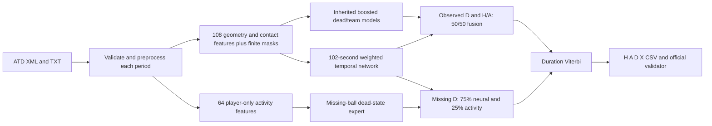

# Ruses Cules — short-possession and missing-ball recovery

## Inputs and contract

The implemented offline model estimates H/A/D from the organizer tactical ATD XML/TXT only. No target labels, video, Smart Tagging or homography enter prediction, training or selection. The output has header frame,label and exactly199,319 rows, indexed0–199318. ATD1-based IDs map to output frame_id−1; IDs/counts/team references are validated. Published graded periods and second-half kickoff determine output coverage and pre-restart D. Outside playing blocks is X.

Coordinates are converted to metres; a detection requires both finite coordinates. XML track slots determine teams, not persistent player identities. Interpolation, derivatives, smoothing and network context reset at periods. Content-hashed, versioned caches are rebuilt on corruption and written atomically. Missing-ball indicators remain available; the new model does not fill gaps with fabricated player-contact locations.

## Implemented architecture



The network runs at5Hz with108 standardized features plus finite masks, width48, seven residual dilation blocks and101.8-second receptive field. Geometry includes distances, nearby counts, team shape, speeds, observation gaps and period-local contact context. Direct and team-swapped predictions are averaged. The inherited boosted models, out-of-fold temporal stacking and geometry paths are unchanged from the audited parent. Future context is allowed because prediction is offline.

The parent network is continued for3000 steps, seed20261116, learning rate0.0001, AdamW weight decay0.001, batch16, preserving the train-only normalizer. H/A supervision weights each training spell by clip(sqrt(10/duration_seconds),1,4). Dead/live loss is doubled on missing-ball frames regardless of class. SkillCorner proxy-D weight0.25 and auxiliary boundary loss0.15 with positive weight8 are retained. Durations use full period-local training reference spells, never development/target labels.

The activity expert is a HistGradientBoosting classifier trained on676,547 sampled missing-ball rows from36 PFF training games, with equal match weights. Its64 features describe period-local player geometry/activity; they exclude ball coordinates, gap duration, identities and network outputs. Fixed settings:150 iterations, learning rate0.05,15 leaves, minimum leaf200,L2=10,max bins128,seed20261116. It affects only D probabilities on missing-ball frames. H/A and observed-ball D keep50/50 inherited/new-neural fusion; missing-ball D uses75% new neural and25% activity expert.

The four-state decoder models H,A,dead-after-H,dead-after-A; both dead states emit D. Minimum live duration is0.4s, minimum D1s, H/A switch cost4.5, other transition costs9, stride5. Restart snapping is disabled. Loose balls and challenges have no separate live class; a touch need not switch ownership, and H-D-H contains two possessions.

## Training provenance


The neural model uses 65 distinct external games: IDSSE/DFL 7, Metrica samples 1/2, SkillCorner A-League 20 and original PFF World Cup release 36. Reference-frame counts before augmentation are 1,002,644 / 286,162 / 2,955,525 / 5,636,115 respectively. The inherited components retain separate overlapping 9-game and 19-game training registries. No supplied-match labels enter fitting or selection.

DFL labels use provider BallStatus/BallPossession (CC BY 4.0). Metrica sample event intervals form an event-derived reference proxy with attribution. SkillCorner automatic H/A phases use complementary within-period D as a proxy (MIT, attribution). PFF references are reconstructed separately through the pinned primary SDK state machine; predictor geometry uses raw visible detections only, excluding estimated/event-informed ball positions, labels and IDs. The original PFF provider grants requested dataset access; a standard permissive license for that release has not been established. The Hugging Face mirror's GPL label is not applied to it. Original provider access and inspection terms remain a qualification to the source-compliance assessment; raw data are not redistributed. See `docs/PFF_SOURCE.md` and the training registries.


All139 scenarios for the65 existing training games were regenerated with corrected features before continuation. The additional activity expert uses only the original36 PFF training games. Runtime checks training registries, normalization shapes, feature schema and model hashes. No extra development match was moved into training.

## Measured quality and limitations

On all ten original development games, official Spell F1 improves0.655317→0.680009 naturally and0.642574→0.667271 under fixed blind sensor stress;9/10 games improve in each. Macro F1 improves0.885608→0.895472 and0.877913→0.892163. Canonical and SDK-shadow event references agree. The unchanged preregistered gates require≥0.020 mean Spell gain,≥8/10 wins,worst loss≤0.020 and mean macro loss≤0.002 in both scenarios/references; the selected model passes.

Natural short-possession recall (<3s,IoU0.5) improves65/578→87/578. Missing-ball false D among reference-live frames decreases20.99%→19.78% (blind22.14%→18.28%), while false-live among reference-D decreases4.42%→2.86% (blind4.21%→3.16%). Recall15.05% still leaves most brief possessions unresolved. Full official Spell F1, not recall alone, determined adoption.

This is repeated development selection across22 changed policies, not a fresh holdout. The six PFF bridges, twelve old final games and all supplied-match labels were excluded from this improvement round. Earlier holdout and public-window scores describe the parent model only. A frozen supplementary check on six DFL/Metrica/SkillCorner training games improves all12 game/scenario cells, but is in-sample. Proxy references, shared provider/countries, sensor jitter and long occlusions limit generalization claims. There is no hidden-match score or finalist-probability estimate.

All136 tests pass; portable predictions exactly match all20 development outputs. Four clean-source CPU generations across macOS ARM/Linux ARM/emulated Linux AMD64 pass official validation and yield identical CSV bytes. One physical host was used. This reproduces inference, not weight training. The original uniform-continuation control and all rejected experiments remain in docs/experiments/.

## Reproduction and delivery

Use Python3.12 and branch release/short-possession-recovery. main remains historical. Model weights are bundled; inference needs no external training download, labels, API key or research cache.

```sh
git clone --branch release/short-possession-recovery --single-branch https://github.com/8Tigran8/silver-octo-winner.git ruses-cules
cd ruses-cules
python3.12 -m venv .venv
.venv/bin/pip install -r requirements-temporal.txt
.venv/bin/python tools/fetch_reference.py
.venv/bin/python tools/generate_recovery_candidate.py \
  --bundle assets/recovery-candidate/bundle.json \
  --data-dir /absolute/path/to/data \
  --output 'Ruses Cules.csv'
.venv/bin/python tools/final_submission_gate.py --csv 'Ruses Cules.csv'
```

The data directory contains tactical/BAR-ATH_tactical_atd.xml and .txt. The generator refuses existing output. Expected CSV SHA-256: `1f4602b5b8b04e4066c5478549a9b5e53f13852ca6513f01422906d1dcb1a1c0`. Tested inference source: `dfc9e860bd28810d0aa768a584eb518e96cee0b6`; the manifest verifies source/model files in the later documentation commit.

The local package is out/recovery-ready/. The repository remains private and organizer submission remains on user hold. Public source availability, original-provider access qualifications and team eligibility must be resolved for unconditional submission readiness. Protected data and per-frame outputs are not committed or redistributed. Full results: docs/experiments/spell-weighted-finetune/REPORT.md.
