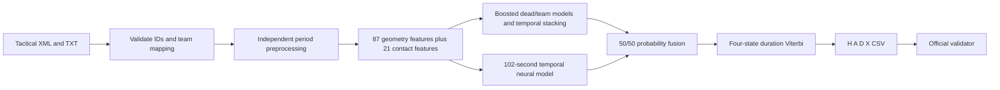

# Ruses Cules — audited possession pipeline

## Approach and inputs

The system estimates H/A/D possession from the supplied automatic tactical XML/TXT. It reads no target reference labels, video, broadcast, homography or raw Smart Tagging events. Published playing blocks and the published second-half kickoff define output coverage and pre-restart D. The output is exactly 199,319 ordered rows with header `frame,label`.

ATD frame IDs are 1-based and must be consecutive; row i is video frame i. XML supplies team membership of anonymous track slots. Coordinates become metres using pitch dimensions. Slots are not persistent player identities. An observation requires both finite coordinates; nonfinite numeric fields become missing, and a lone ball observation is retained by endpoint interpolation. The cache is keyed by SHA-256 of both input files and a parser version. Damaged cache shapes/IDs/archives are rebuilt from source; writes are atomic.

## Implemented architecture



Geometry includes observed/interpolated ball positions, missingness durations, distances to the two nearest observations per team, nearby-player counts, team shape, player speeds and short temporal windows. All interpolation, derivatives and windows now reset at published periods. Equal-distance nearest-player speed uses the mean of tied detections. Observed-contact features carry past/future geometry within each period only.

The inherited boosted pipeline uses a dead-ball classifier, a live home/away classifier, out-of-fold temporal stacking and a contact-context team classifier. Stacking also resets at periods. Direct and team-swapped estimates are averaged. The neural branch takes 108 standardized features plus finite-value masks at 5 Hz, width 48, seven residual dilation blocks and a 101.8-second receptive field. It was trained with frame supervision plus auxiliary boundary loss. Inference is offline and uses future context; context cannot cross periods.

Dead-ball and conditional-home probabilities are fused 50/50 between the inherited and neural paths. A four-state Viterbi decoder represents H, A, dead-after-H and dead-after-A; both dead states emit D. Transition cost is 9 and minimum live/dead duration is one second. Restart snapping is disabled. The supplied game's labels are generated entirely by this algorithm.

## Training provenance

The neural model uses 65 distinct external games: IDSSE/DFL 7, Metrica samples 1/2, SkillCorner A-League 20 and original PFF World Cup release 36. Reference-frame counts before augmentation are 1,002,644 / 286,162 / 2,955,525 / 5,636,115 respectively. The inherited components retain separate overlapping 9-game and 19-game training registries. No supplied-match labels enter fitting or selection.

DFL labels use provider BallStatus/BallPossession (CC BY 4.0). Metrica sample event intervals form an event-derived reference proxy with attribution. SkillCorner automatic H/A phases use complementary within-period D as a proxy (MIT, attribution). PFF references are reconstructed separately through the pinned primary SDK state machine; predictor geometry uses raw visible detections only, excluding estimated/event-informed ball positions, labels and IDs. The original PFF provider grants requested dataset access; a standard permissive license for that release has not been established. The Hugging Face mirror's GPL label is not applied to it. Original provider access and inspection terms remain a qualification to the source-compliance assessment; raw data are not redistributed. See `docs/PFF_SOURCE.md` and the training registries.

## Possession interpretation and limitations

Control is inferred from geometry and temporal evidence; every touch does not automatically switch possession. Loose balls and challenges have no fourth live state. Stoppages interrupt possessions, including H-D-H. Semantic tests of injected evidence verify decoder behaviour; they do not establish that noisy geometry distinguishes every deflection, referee decision or aerial duel.

Short possessions are a major weakness. The one-second minimum deliberately suppresses some real very short possessions. Missing ball, duplicate detections, long occlusions and independent coordinate jitter remain risks. The standalone neural model has a large full-fit/held-out gap on only two Metrica games (~0.151). External reference definitions differ from the organizer's corrected-tracking labels; neither synthetic tests nor public-window scores remove that shift.

## Evaluation and repair evidence

Before this audit, frozen boundary102 improved the one-shot 12-game PFF final from 0.54180 to 0.60428 Spell F1, with 12/12 natural wins. Those are results for the original source and event-proxy references, not a new validation of repaired source. The final is consumed and was not reopened here.

This audit repaired cross-period features/stacking, stale cache selection, equal-distance slot dependence and short-input feature shape. Corrected-source regression on the existing ten PFF development games gives Spell F1 0.655317 natural and 0.642574 blind; mean gains versus original boundary102 are only +0.000086/+0.000088. These are regression checks, not independent fresh generalization evidence.

Further missing-coordinate/cache repairs leave all ten development-game metrics unchanged in both scenarios. Two fresh-source runs each on macOS ARM, local Linux ARM and emulated Linux x86-64 generate exactly the same target CSV as before the repairs. Linux inference has network disabled and only the two original tracking files mounted read-only. These are cross-OS/architecture checks on the same physical host, not independent hardware validation.

Full-model toy geometry with 22 moving players recognizes obvious constant H/A control (synthetic Spell F1 1.0). A ten-second hidden-ball interval instead introduces false D (synthetic Spell F1 0.4). This is a diagnostic limitation, not a real-match estimate; success on injected decoder evidence does not resolve it. Experimental player-relative gap filling is separate from production inference.

The one frozen-candidate public-window diagnostic is 0.6000 Spell F1 / 0.7548 macroF1 on 17 possessions: **DIAGNOSTIC ONLY — NOT A GENERALIZATION ESTIMATE**. It was not used for model selection or tuning and was not rerun after these repairs.

## Reproduction

Use Python 3.12 and the audited source commit in `submission_manifest.json`:

```sh
python3.12 -m venv .venv
.venv/bin/pip install -r requirements-temporal.txt
.venv/bin/python tools/fetch_reference.py
.venv/bin/python tools/generate_mixed_candidate.py \
  --bundle assets/pff-mixed-candidate/bundle.json \
  --data-dir /absolute/path/to/data \
  --output 'Ruses Cules.csv'
.venv/bin/python ref/official/evaluation/validate_submission.py 'Ruses Cules.csv'
```

The data directory must contain tactical/BAR-ATH_tactical_atd.xml and .txt. Weights are included and checked by hash. Generating the file needs no PFF download, training cache, API key or notebook state. The generator refuses to overwrite an existing output.

Expected CSV SHA-256: `cfbd16ea35075a199d2401c18f162d4c1f953be4049cd776d502ff42ea389c97`.

Audit code and documentation are on `codex/independent-audit`. The repository remains private under the user's publication hold; organizer upload has not occurred. This document describes implemented behaviour and does not promise hidden-match score or finalist probability.
